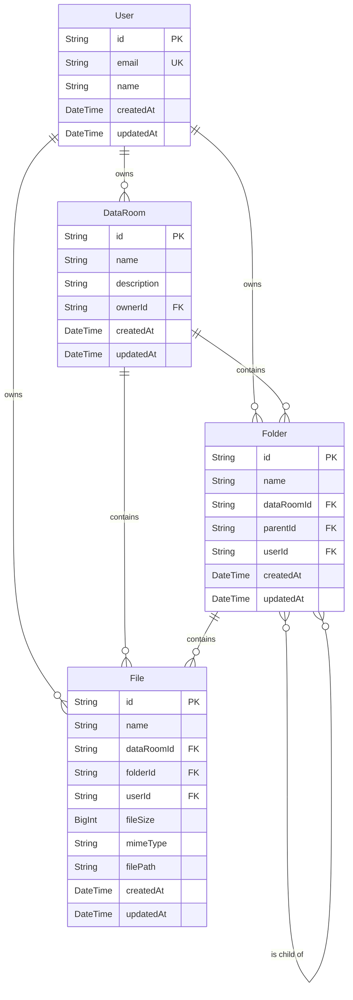

# System Architecture Document

This document provides a detailed overview of the technical architecture of the Data Room application.

## 1. High-Level Architecture

The application follows a **client-server model** with a modern web stack. It is structured as a **monorepo** containing two main projects:

-   `frontend`: A Single Page Application (SPA) built with React.
-   `backend`: A RESTful API built with Node.js and Express.

This structure simplifies development, dependency management, and deployment.

### Core Technologies

-   **Frontend**: React, TypeScript, React Router, TanStack Query, Tailwind CSS
-   **Backend**: Node.js, Express, TypeScript, Prisma
-   **Database**: Supabase (PostgreSQL)
-   **Deployment**: Vercel

---

## 2. Frontend Architecture

The frontend is a modern, performant, and maintainable React application.

### 2.1. Core Framework & Language

-   **React**: The UI is built using React for its component-based architecture and declarative nature.
-   **TypeScript**: We use TypeScript for static typing, which improves code quality, developer experience, and reduces runtime errors.
-   **Create React App (CRA) with Craco**: The project is bootstrapped with CRA and customized using `Craco` to allow for configuration overrides (like Tailwind CSS) without ejecting.

### 2.2. Routing

-   **React Router DOM (`v6`)**: Handles all client-side routing. The application uses a centralized routing setup in `App.tsx` which includes:
    -   Public and private routes.
    -   Lazy loading of pages/components using `React.lazy` and `Suspense` for better initial load performance.
    -   A `PrivateRoute` component to protect routes that require authentication.

### 2.3. State Management & Data Fetching

-   **TanStack Query (React Query)**: Used as the primary tool for server state management. It handles data fetching, caching, synchronization, and updates with excellent developer experience.
    -   **Caching Strategy**: A default caching strategy is configured in `App.tsx` with a `staleTime` of 1 minute and a `gcTime` (garbage collection) of 5 minutes.
-   **React Context API**: Used for global UI state, specifically for authentication (`AuthContext`). It provides user and session information to all components in the application.
-   **Axios**: The HTTP client used to make requests to the backend API.

### 2.4. UI & Styling

-   **Tailwind CSS**: A utility-first CSS framework for rapid UI development.
-   **Radix UI**: Provides unstyled, accessible UI primitives which are used as a base for custom components. This is indicative of a `shadcn/ui`-like setup.
-   **Component Library**: The UI is built with a custom component library located in `src/components/ui`, ensuring a consistent look and feel across the application.
-   **lucide-react**: Used for icons.

### 2.5. Folder Structure

The `frontend/src` directory is organized as follows:

```
/src
├── /components       # Reusable UI components
│   ├── /ui           # Base UI components (Button, Card, etc.)
│   └── Layout.tsx
│   └── PrivateRoute.tsx
├── /contexts         # React Context providers (e.g., AuthContext)
├── /hooks            # Custom React hooks
├── /pages            # Top-level page components (lazily loaded)
├── /services         # API service layer (Axios configurations)
├── /utils            # Utility functions
├── App.tsx           # Root component with routing setup
└── index.tsx         # Application entry point
```

---

## 3. Backend Architecture

The backend is a robust and scalable Node.js application built with Express.

### 3.1. Core Framework & Language

-   **Node.js**: The runtime environment.
-   **Express.js**: A minimal and flexible web application framework for Node.js. It's used to define the REST API routes and middleware.
-   **TypeScript**: Ensures type safety and better code organization.

### 3.2. API Design

-   **RESTful API**: The backend exposes a RESTful API for the frontend to consume.
-   **Routing**: Routes are modularized and located in the `src/routes` directory (e.g., `authRoutes`, `dataRoomRoutes`).
-   **Middleware**: The application makes extensive use of Express middleware for:
    -   **Security**: `helmet` for setting various HTTP headers, `cors` for Cross-Origin Resource Sharing, `express-rate-limit` to prevent brute-force attacks.
    -   **Authentication**: A custom `authenticateToken` middleware to protect routes.
    -   **Logging**: `morgan` for HTTP request logging.
    -   **Error Handling**: A centralized `errorHandler` middleware.
    -   **File Uploads**: `multer` is used for handling multipart/form-data, primarily for file uploads.

### 3.3. Database & ORM

-   **Supabase (PostgreSQL)**: The primary database. Supabase provides a managed PostgreSQL instance with additional features like authentication and storage.
-   **Prisma**: A next-generation ORM for Node.js and TypeScript.
    -   **Schema Definition**: The database schema is defined in `prisma/schema.prisma`.
    -   **Type Safety**: Prisma Client is auto-generated from the schema, providing fully type-safe database queries.
    -   **Migrations**: Prisma Migrate is used for declarative database schema migrations.

### 3.4. Folder Structure

The `backend/src` directory is organized as follows:

```
/src
├── /config           # Environment configuration
├── /controllers      # Route handlers (business logic)
├── /middleware       # Express middleware (auth, errorHandler)
├── /routes           # API route definitions
├── /services         # Services for interacting with external APIs or complex logic
├── /utils            # Utility functions
├── index.ts          # Application entry point, server and middleware setup
```

---

## 4. Authentication

-   **Supabase Auth**: Authentication is handled by Supabase. The frontend interacts directly with Supabase for user sign-up, sign-in (Google OAuth), and session management.
-   **JWT (JSON Web Tokens)**: Supabase issues JWTs to authenticated users. The frontend stores this token and sends it in the `Authorization` header of every request to the backend.
-   **Backend Token Validation**: The `authenticateToken` middleware on the backend verifies the JWT signature with Supabase's public key to authorize requests.

---

## 5. Deployment & DevOps

-   **Vercel**: The entire application (both frontend and backend) is deployed on Vercel.
-   **Frontend Deployment**: Deployed as a static site using `@vercel/static-build`. The `frontend/vercel.json` file configures rewrites to ensure client-side routing works correctly.
-   **Backend Deployment**: Deployed as **Vercel Serverless Functions** using `@vercel/node`. Each API route becomes a serverless function.
-   **CI/CD**: Vercel provides automated builds and deployments triggered by `git push` to the main branch.
-   **Environment Variables**: Vercel's dashboard is used to manage environment variables for both frontend (`REACT_APP_*`) and backend (`DATABASE_URL`).

---

## 6. Database Schema (ERD)

The following diagram illustrates the relationships between the main entities in the database.


