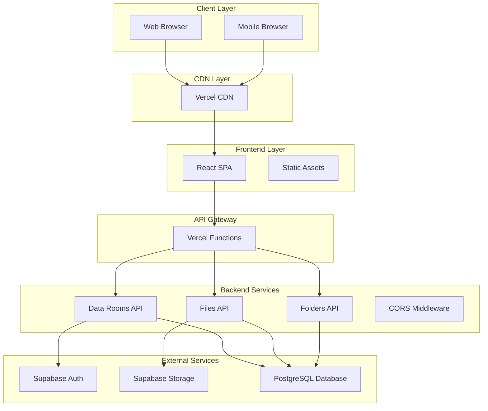
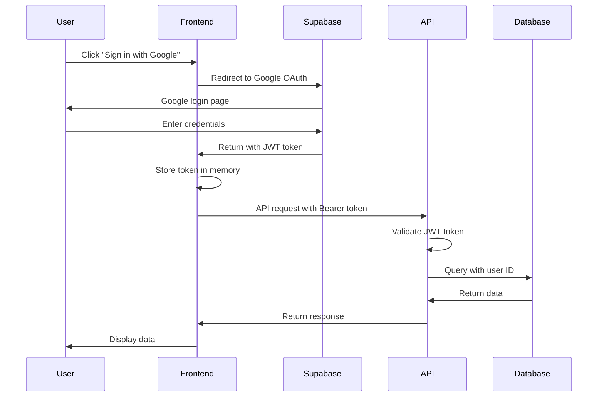
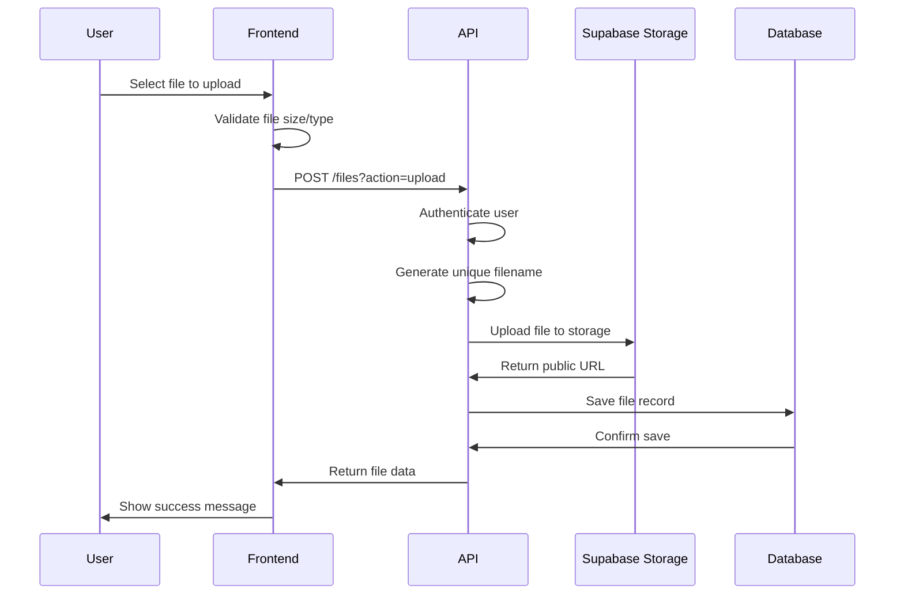
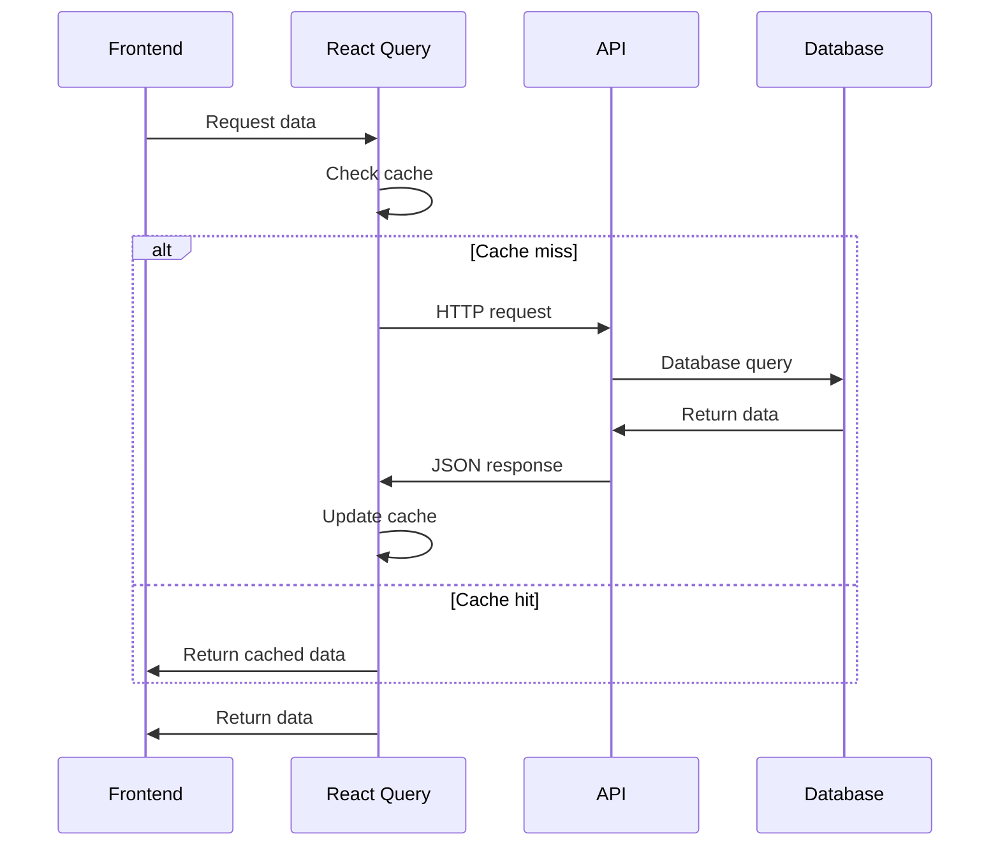
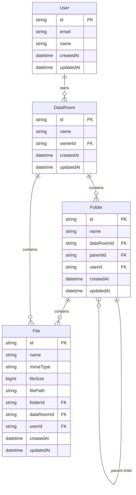
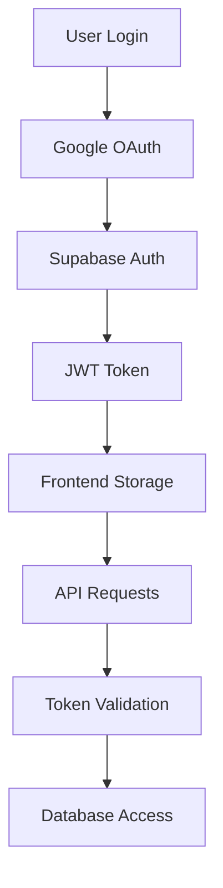
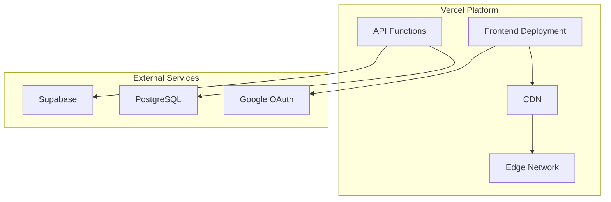
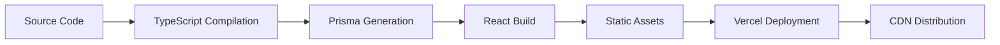

# 🏗️ Data Room - System Architecture

This document provides a comprehensive overview of the Data Room application architecture, including system design, data flow, security considerations, and scalability patterns.

## 📋 Table of Contents

- [System Overview](#system-overview)
- [Architecture Patterns](#architecture-patterns)
- [Technology Stack](#technology-stack)
- [Data Flow](#data-flow)
- [Database Design](#database-design)
- [API Design](#api-design)
- [Frontend Architecture](#frontend-architecture)
- [Security Architecture](#security-architecture)
- [Deployment Architecture](#deployment-architecture)
- [Performance Considerations](#performance-considerations)
- [Scalability Patterns](#scalability-patterns)

## 🎯 System Overview

The Data Room application is a **full-stack web application** designed for secure document management and collaboration. It follows a **client-server architecture** with a **serverless backend** and a **single-page application frontend**.

### High-Level Architecture



## 🏛️ Architecture Patterns

### 1. **Serverless Architecture**
- **Backend**: Vercel serverless functions
- **Benefits**: Auto-scaling, pay-per-use, no server management
- **Pattern**: Function-per-endpoint with shared middleware

### 2. **Single Page Application (SPA)**
- **Frontend**: React with client-side routing
- **Benefits**: Fast navigation, rich user experience
- **Pattern**: Component-based architecture with lazy loading

### 3. **API-First Design**
- **Backend**: RESTful APIs with JSON responses
- **Benefits**: Decoupled frontend/backend, easy testing
- **Pattern**: Resource-based URLs with HTTP methods

### 4. **Database-First Development**
- **ORM**: Prisma with schema-first approach
- **Benefits**: Type safety, automatic migrations
- **Pattern**: Schema definition drives API design

### 5. **Authentication as a Service**
- **Provider**: Supabase Auth with Google OAuth
- **Benefits**: Reduced complexity, enterprise-grade security
- **Pattern**: JWT tokens with stateless validation

## 🛠️ Technology Stack

### Frontend Stack

```
┌─────────────────────────────────────────┐
│                Browser                   │
├─────────────────────────────────────────┤
│              React 19                   │
│           + TypeScript                  │
├─────────────────────────────────────────┤
│         React Query (TanStack)           │
│         React Router v7                  │
├─────────────────────────────────────────┤
│            Tailwind CSS                 │
│           Lucide Icons                  │
├─────────────────────────────────────────┤
│              Axios                     │
│         Supabase Client                 │
└─────────────────────────────────────────┘
```

**Key Technologies:**
- **React 19**: Latest React with concurrent features
- **TypeScript**: Type safety and better developer experience
- **React Query**: Server state management and caching
- **React Router**: Client-side routing
- **Tailwind CSS**: Utility-first CSS framework
- **Axios**: HTTP client for API communication

### Backend Stack

```
┌─────────────────────────────────────────┐
│           Vercel Functions              │
├─────────────────────────────────────────┤
│            Node.js 18+                  │
│           + TypeScript                  │
├─────────────────────────────────────────┤
│              Express                    │
│         CORS Middleware                 │
├─────────────────────────────────────────┤
│              Prisma                    │
│         JWT Validation                  │
├─────────────────────────────────────────┤
│           PostgreSQL                    │
│         Supabase Storage                │
└─────────────────────────────────────────┘
```

**Key Technologies:**
- **Vercel Functions**: Serverless function execution
- **Node.js**: JavaScript runtime
- **Express**: Web framework (legacy, being phased out)
- **Prisma**: Database ORM and query builder
- **PostgreSQL**: Relational database
- **Supabase**: Backend-as-a-Service platform

## 🔄 Data Flow

### Authentication Flow



### File Upload Flow



### Data Fetching Flow



## 🗄️ Database Design

### Entity Relationship Diagram



### Database Schema (Prisma)

```prisma
model User {
  id        String   @id @default(cuid())
  email     String   @unique
  name      String?
  createdAt DateTime @default(now())
  updatedAt DateTime @updatedAt
  
  // Relations
  dataRooms DataRoom[]
  folders   Folder[]
  files     File[]
}

model DataRoom {
  id        String   @id @default(cuid())
  name      String
  ownerId   String
  createdAt DateTime @default(now())
  updatedAt DateTime @updatedAt
  
  // Relations
  owner   User     @relation(fields: [ownerId], references: [id], onDelete: Cascade)
  folders Folder[]
  files   File[]
}

model Folder {
  id         String   @id @default(cuid())
  name       String
  dataRoomId String
  parentId   String?
  userId     String
  createdAt  DateTime @default(now())
  updatedAt  DateTime @updatedAt
  
  // Relations
  dataRoom DataRoom @relation(fields: [dataRoomId], references: [id], onDelete: Cascade)
  parent   Folder?  @relation("FolderHierarchy", fields: [parentId], references: [id], onDelete: Cascade)
  children Folder[] @relation("FolderHierarchy")
  files    File[]
  user     User     @relation(fields: [userId], references: [id], onDelete: Cascade)
}

model File {
  id         String   @id @default(cuid())
  name       String
  mimeType   String
  fileSize   BigInt
  filePath   String
  folderId   String?
  dataRoomId String
  userId     String
  createdAt  DateTime @default(now())
  updatedAt  DateTime @updatedAt
  
  // Relations
  folder   Folder?   @relation(fields: [folderId], references: [id], onDelete: Cascade)
  dataRoom DataRoom  @relation(fields: [dataRoomId], references: [id], onDelete: Cascade)
  user     User      @relation(fields: [userId], references: [id], onDelete: Cascade)
}
```

### Database Indexes

```sql
-- Performance indexes
CREATE INDEX idx_datroom_owner ON "DataRoom"("ownerId");
CREATE INDEX idx_folder_datroom ON "Folder"("dataRoomId");
CREATE INDEX idx_folder_parent ON "Folder"("parentId");
CREATE INDEX idx_file_folder ON "File"("folderId");
CREATE INDEX idx_file_datroom ON "File"("dataRoomId");
CREATE INDEX idx_file_user ON "File"("userId");

-- Composite indexes for common queries
CREATE INDEX idx_folder_datroom_parent ON "Folder"("dataRoomId", "parentId");
CREATE INDEX idx_file_datroom_folder ON "File"("dataRoomId", "folderId");
```

## 🔌 API Design

### RESTful API Endpoints

#### Data Rooms API (`/api/data-rooms`)

```typescript
// List all data rooms for user
GET /api/data-rooms
Response: { success: boolean, data: DataRoom[], pagination: PaginationInfo }

// Create new data room
POST /api/data-rooms
Body: { name: string }
Response: { success: boolean, data: DataRoom, message: string }

// Get specific data room
GET /api/data-rooms?id={id}
Response: { success: boolean, data: DataRoom }

// Delete data room
DELETE /api/data-rooms?id={id}
Response: { success: boolean, message: string }

// Get folders in data room
GET /api/data-rooms?id={id}&action=folders
Response: { success: boolean, data: Folder[] }

// Get files in data room
GET /api/data-rooms?id={id}&action=files&all=true
Response: { success: boolean, data: File[] }
```

#### Folders API (`/api/folders`)

```typescript
// Create folder
POST /api/folders
Body: { name: string, dataRoomId: string, parentId?: string }
Response: { success: boolean, data: Folder, message: string }

// Get folder details
GET /api/folders?id={id}
Response: { success: boolean, data: Folder }

// Update folder
PATCH /api/folders?id={id}
Body: { name: string }
Response: { success: boolean, data: Folder, message: string }

// Delete folder
DELETE /api/folders?id={id}
Response: { success: boolean, message: string }

// Get files in folder
GET /api/folders?id={id}&action=files
Response: { success: boolean, data: File[] }
```

#### Files API (`/api/files`)

```typescript
// Upload file
POST /api/files?action=upload
Body: FormData { file: File, name: string, folderId: string }
Response: { success: boolean, data: File, message: string }

// Update file
PATCH /api/files?id={id}
Body: { name: string }
Response: { success: boolean, data: File, message: string }

// Delete file
DELETE /api/files?id={id}
Response: { success: boolean, message: string }
```

### API Response Format

```typescript
interface ApiResponse<T> {
  success: boolean;
  data?: T;
  message?: string;
  error?: string;
  pagination?: {
    page: number;
    limit: number;
    total: number;
    totalPages: number;
  };
}
```

### Error Handling

```typescript
// Standard HTTP status codes
200 OK           // Success
201 Created      // Resource created
400 Bad Request  // Invalid input
401 Unauthorized // Authentication required
403 Forbidden    // Insufficient permissions
404 Not Found    // Resource not found
409 Conflict     // Duplicate resource
500 Internal Server Error // Server error

// Error response format
{
  "error": "Error type",
  "message": "Human-readable error message",
  "details": "Additional error information"
}
```

## 🎨 Frontend Architecture

### Component Hierarchy

```
App
├── QueryClientProvider
├── AuthProvider
└── Router
    ├── Public Routes
    │   ├── Login
    │   └── Signup
    └── Private Routes
        └── Layout
            ├── Header
            ├── Sidebar (FileTree)
            └── Main Content
                ├── DataRooms (List View)
                └── DataRoomView (Detail View)
                    ├── Breadcrumb
                    ├── Search Bar
                    ├── Action Buttons
                    ├── Folders Grid
                    └── Files List
```

### State Management

#### React Query (Server State)
- **Data Fetching**: Automatic caching and background updates
- **Mutations**: Optimistic updates and error handling
- **Cache Management**: Automatic invalidation and garbage collection

#### React Context (Client State)
- **Authentication**: User session and login state
- **UI State**: Modal states, form data, etc.

#### Local State (Component State)
- **Form Inputs**: Controlled components
- **UI Interactions**: Hover states, selections, etc.

### Performance Optimizations

#### Code Splitting
```typescript
// Lazy load pages
const Login = lazy(() => import('./pages/Login'));
const DataRooms = lazy(() => import('./pages/DataRooms'));
```

#### Memoization
```typescript
// Prevent unnecessary re-renders
const FileTree = memo(({ folders, files, onFolderClick }) => {
  // Component implementation
});

// Memoize expensive calculations
const filteredData = useMemo(() => {
  return expensiveFilter(data);
}, [data, filterCriteria]);
```

#### Debouncing
```typescript
// Debounce search input
const [searchInput, setSearchInput] = useState('');
const [debouncedSearch, setDebouncedSearch] = useState('');

useEffect(() => {
  const timer = setTimeout(() => {
    setDebouncedSearch(searchInput);
  }, 300);
  return () => clearTimeout(timer);
}, [searchInput]);
```

## 🔒 Security Architecture

### Authentication Flow



### Security Layers

#### 1. **Authentication Layer**
- **Provider**: Supabase Auth with Google OAuth
- **Token**: JWT with user ID and expiration
- **Storage**: In-memory (no localStorage for security)

#### 2. **Authorization Layer**
- **API**: User ID validation on every request
- **Database**: Row Level Security (RLS) policies
- **Files**: User-specific access controls

#### 3. **Network Security**
- **HTTPS**: All communications encrypted
- **CORS**: Restricted to allowed origins
- **Headers**: Security headers via middleware

#### 4. **Data Security**
- **Encryption**: Files encrypted in Supabase Storage
- **Validation**: Input validation on all endpoints
- **Sanitization**: XSS protection in frontend

### CORS Configuration

```typescript
const allowedOrigins = [
  'https://data-room-196e.vercel.app',  // Production
  'http://localhost:3000',             // Development
  'http://localhost:3001'              // Alternative port
];

// CORS headers
res.setHeader('Access-Control-Allow-Origin', allowedOrigin);
res.setHeader('Access-Control-Allow-Credentials', 'true');
res.setHeader('Access-Control-Allow-Methods', 'GET,POST,PATCH,DELETE,OPTIONS');
res.setHeader('Access-Control-Allow-Headers', 'Content-Type,Authorization');
```

## 🚀 Deployment Architecture

### Vercel Deployment



### Environment Configuration

#### Development
```env
# Local development with hot reload
NODE_ENV=development
REACT_APP_API_URL=http://localhost:3001
DATABASE_URL=postgresql://localhost:5432/datroom_dev
```

#### Production
```env
# Production with optimizations
NODE_ENV=production
REACT_APP_API_URL=https://api.vercel.app
DATABASE_URL=postgresql://prod-server:5432/datroom_prod
```

### Build Process



## ⚡ Performance Considerations

### Frontend Performance

#### 1. **Bundle Optimization**
- **Code Splitting**: Lazy load routes and components
- **Tree Shaking**: Remove unused code
- **Minification**: Compress JavaScript and CSS

#### 2. **Caching Strategy**
- **React Query**: Automatic caching with stale-while-revalidate
- **Browser Cache**: Static assets cached via CDN
- **Service Worker**: Offline capability (future enhancement)

#### 3. **Rendering Optimization**
- **Virtual Scrolling**: For large file lists (future enhancement)
- **Memoization**: Prevent unnecessary re-renders
- **Debouncing**: Reduce API calls for search

### Backend Performance

#### 1. **Database Optimization**
- **Indexes**: Optimized queries with proper indexing
- **Connection Pooling**: Efficient database connections
- **Query Optimization**: Prisma query optimization

#### 2. **API Performance**
- **Caching**: Response caching where appropriate
- **Compression**: Gzip compression for responses
- **Rate Limiting**: Prevent abuse and ensure fair usage

#### 3. **File Handling**
- **Streaming**: Large file uploads via streaming
- **CDN**: File serving via Supabase CDN
- **Compression**: Image optimization (future enhancement)

### Performance Metrics

```typescript
// Key performance indicators
interface PerformanceMetrics {
  // Frontend metrics
  firstContentfulPaint: number;    // < 1.5s
  largestContentfulPaint: number;  // < 2.5s
  cumulativeLayoutShift: number;    // < 0.1
  timeToInteractive: number;        // < 3.5s
  
  // API metrics
  apiResponseTime: number;          // < 200ms
  databaseQueryTime: number;        // < 100ms
  fileUploadTime: number;           // < 5s for 10MB
  
  // User experience
  searchResponseTime: number;       // < 300ms
  navigationTime: number;           // < 100ms
}
```

## 📈 Scalability Patterns

### Horizontal Scaling

#### 1. **Serverless Functions**
- **Auto-scaling**: Vercel functions scale automatically
- **Cold Start**: Optimized for fast cold starts
- **Concurrency**: Handle multiple requests simultaneously

#### 2. **Database Scaling**
- **Connection Pooling**: Efficient connection management
- **Read Replicas**: Distribute read load (future enhancement)
- **Partitioning**: Partition by user ID (future enhancement)

#### 3. **CDN Distribution**
- **Global CDN**: Vercel's edge network
- **Static Assets**: Cached at edge locations
- **API Responses**: Cached where appropriate

### Vertical Scaling

#### 1. **Resource Optimization**
- **Memory Usage**: Efficient memory management
- **CPU Usage**: Optimized algorithms and queries
- **Storage**: Efficient file storage and retrieval

#### 2. **Caching Layers**
- **Application Cache**: React Query caching
- **Database Cache**: Query result caching
- **CDN Cache**: Static asset caching


---

**This architecture document is living documentation that evolves with the application.**
